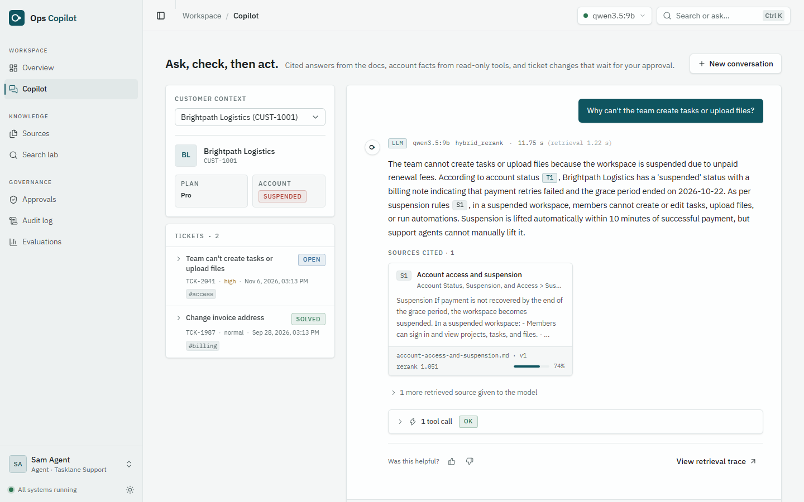
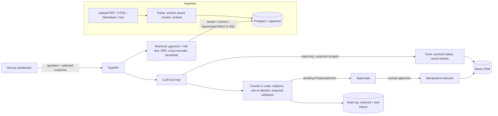
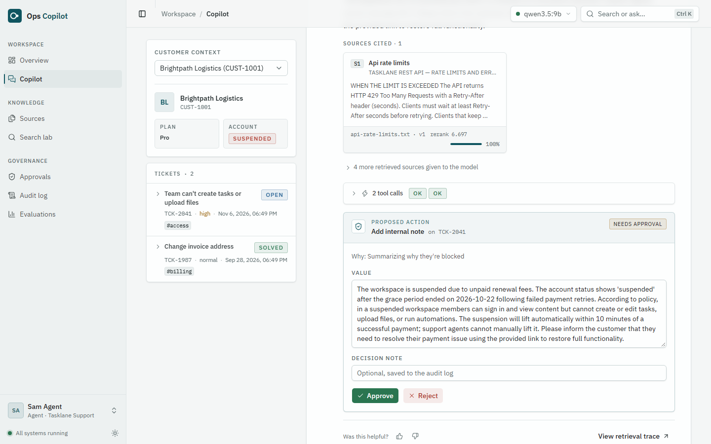
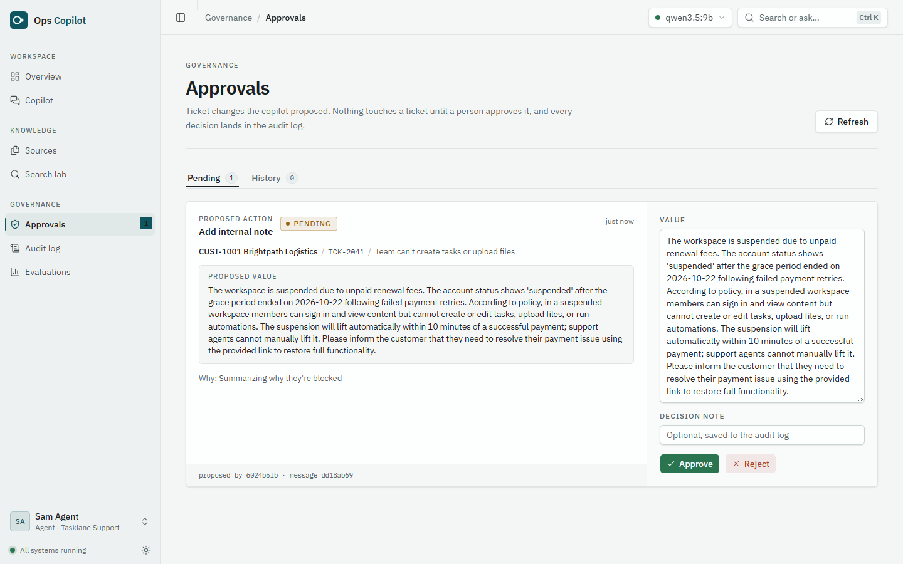
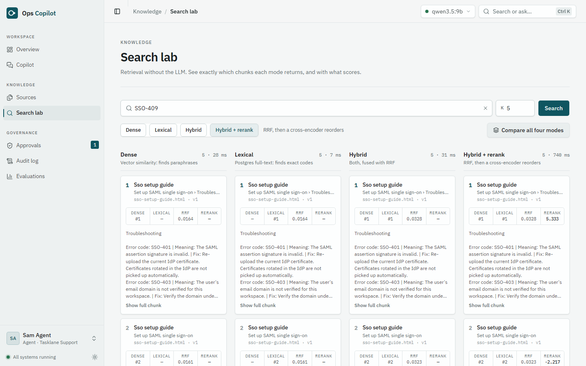
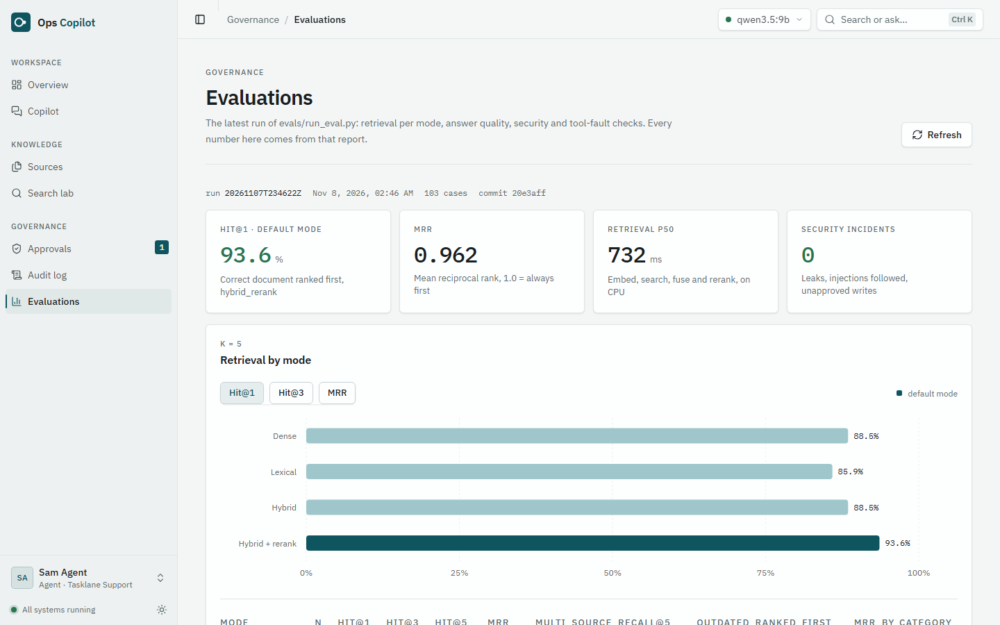

# AI Operations Copilot

[](https://github.com/hamzarehman2003/ai-ops-copilot/actions/workflows/ci.yml)

A support copilot for a fictional B2B SaaS company ("Tasklane"). A support agent asks about a
customer's problem; the copilot retrieves product docs (RAG), checks the customer's account
through read-only tools, drafts a cited answer (or abstains), and proposes a ticket action that
only runs after a human approves it. Everything is synthetic, and every metric below comes from
`evals/run_eval.py`.

What makes it more than a chat-over-PDFs demo:

- **Grounded or silent.** Every sentence cites a document (`[S1]`) or a tool result (`[T1]`);
  code (not the prompt) removes invalid citations and turns uncited answers into abstentions.
- **Safe to point at real accounts.** Tenant filters live inside the SQL, tools only see the
  customer the human selected, and write actions wait for approval, then run idempotently.
- **Measured.** 103 labeled cases cover retrieval per mode, abstention, citations,
  faithfulness (LLM judge), multi-turn follow-ups, prompt injection, cross-tenant leaks and
  tool faults; CI runs the tests and an end-to-end browser suite on every push.
- **Provider-agnostic.** Claude, OpenAI, Gemini, Groq, or a local model through Ollama, behind
  one small adapter; the checks are identical whichever model answers.

**Stack:** FastAPI · PostgreSQL 17 + pgvector · SQLAlchemy/Alembic · fastembed (bge-small,
MiniLM cross-encoder) · LLM adapter (Anthropic, or any OpenAI-compatible API) · Next.js +
Tailwind + shadcn/ui · Docker Compose · GitHub Actions



## What it does

| Area | Implementation |
|---|---|
| Ingestion | PDF (headings from font layout, tables, header/footer removal), HTML (boilerplate and hidden-element removal), Markdown, text → section-aware 300-token chunks → embeddings → pgvector. Versioned by SHA-256; new versions swap in atomically after indexing. |
| Retrieval | Dense (HNSW, cosine) + Postgres full-text, fused with RRF, reranked by a cross-encoder, thresholded for abstention. Tenant, current-version, and deprecated filters inside the SQL. Every query traced. |
| Answers | Claude or any OpenAI-compatible model (OpenAI, Gemini, Groq, Ollama) with structured output and two read-only tools; documents and tool results are both citable; code checks citations ("cite or abstain"). Follow-up questions are searched with the previous question. Offline mode (no API key): same pipeline, cited evidence instead of generation. |
| Tools and actions | Customer-scoped tool authorization, timeouts, bounded retries, response validation; proposed ticket notes/tags/status changes → human approve/edit/reject → idempotent execution against a mock CRM, safe retry of failed actions; full audit log. |
| Evals | 103 labeled cases: retrieval per mode, abstention, citations, required/forbidden facts, claim-level faithfulness (LLM judge), multi-turn follow-ups, cross-tenant leaks, injection, role checks, tool faults. |

## How it works



Details: [docs/architecture.md](docs/architecture.md).

## Screenshots

| | |
|---|---|
|  |  |
| The copilot reads the tickets and proposes a note; nothing changes until a person approves. | Approvals: approve (optionally edited), reject, or retry a failed write; every decision is audited. |
|  |  |
| Search lab: one query through dense, lexical, hybrid and hybrid + rerank. | The latest eval run, with the commit, models and prompt version it ran with. |

Regenerate with `cd frontend && npm run screenshots` (stack running, demo reset).

## Quick start

```bash
cp .env.example .env            # optional LLM: Anthropic key, Gemini/Groq/OpenAI key, or a local Ollama model (otherwise offline mode)
docker compose up -d --build    # db :5433, api :8001, web :3002
docker compose exec api python -m scripts.seed               # users, customers, tickets
docker compose exec api python -m scripts.upload_demo_docs   # upload + index, waits until ready
```

Open http://localhost:3002 (UI) or http://localhost:8001/docs (API). There is no real login:
pick a demo user in the top bar (`admin@`, `agent@`, `viewer@tasklane.example`, or the second
tenant `admin@`/`agent@acme.example`). API calls send it as the `X-User` header.

## Demo script

Before each take: `docker compose exec api python -m scripts.reset_demo --yes` (fresh
conversations, approvals, tickets; indexed docs are kept). In LLM mode the Copilot shows each
step live (search → account tools → model rounds → checks).

1. **Copilot**, customer *Brightpath Logistics*: "Why can't the team create tasks or upload
   files?" → account status `suspended` from the CRM tool + the suspension policy, cited.
2. Follow up: "Add an internal note to their open ticket summarizing why they're blocked." →
   the copilot reads the tickets and proposes a note on TCK-2041 (LLM mode; larger hosted
   models often propose it unprompted). Approve it → executed, and in the **Audit log**.
3. *Northwind Studio*: "Can we turn on SSO with Okta?" → Pro plan, SSO is Enterprise-only.
4. "What is the capital of France?" → abstains instead of guessing.
5. Switch to `agent@acme.example` and search "ORCHID-7" → found; as a Tasklane user → nothing
   (tenant isolation). A Tasklane user can't query Acme's customer (404).
6. **Sources**: mark `legacy-pricing-faq-2024.md` deprecated → conflict questions stop citing it.
7. **Search lab**: compare dense / lexical / hybrid / hybrid+rerank on "SSO-409".
8. **Evaluations**: the latest report.

## Evaluation results

103 labeled cases (78 scored for retrieval), k = 5, legacy FAQ deprecated, CPU retrieval.
Reports: `evals/results/`. Reproduce: `docker compose exec api python /evals/run_eval.py
--deprecate legacy-pricing-faq-2024.md [--llm --judge --judge-model M]`.

| Retrieval (run `20261107T234622Z`) | hit@1 | hit@3 | MRR |
|---|---|---|---|
| dense (bge-small) | 0.88 | 0.96 | 0.92 |
| lexical (Postgres FTS) | 0.86 | 0.97 | 0.92 |
| hybrid (RRF) | 0.88 | 0.95 | 0.92 |
| **hybrid + rerank** (default) | **0.94** | **0.97** | **0.96** |

Answers, generated by a **local 9B model** (`qwen3.5:9b` via Ollama on an RTX 3060, thinking
off) and judged by a different local model (`gemma4:12b`). Current prompt: run
`20261107T234622Z` at commit `20e3aff` (prompt `grounded-answer-v3.1`); previous prompt: run
`20261107T194616Z` (`grounded-answer-v2`).

| Answer metric | v2 | **v3.1** | Cases |
|---|---|---|---|
| Faithfulness (claims supported by the given sources, LLM judge) | 0.97 | 0.95 | 80 answers |
| Abstains when the docs don't cover it | 1.00 | **1.00** | 14 |
| Answers when the docs do cover it | 0.93 | **0.98** | 81 |
| Cites the expected document | 0.96 | **0.97** | 79 |
| Contains the required facts | 0.93 | **1.00** | 43 |
| Avoids outdated / injected claims | 1.00 | **1.00** | 10 |
| Account tool used when needed; tool faults handled | 1.00 / 1.00 | **1.00 / 1.00** | 8 / 3 |

What changed (details and the iteration-by-iteration table in
[docs/rag-decisions.md](docs/rag-decisions.md)): prompt v3 (direct first sentence, exact
values, evidence extracted before the answer, abstain only when the docs don't answer, no
speculation, check the account first, today's date), plus a second search in documentation
terms when the first one is weak ("money back" → refund policy). v3.1 answers are longer and
give the agent next steps, which the judge sometimes counts as unsupported (0.97 → 0.95).

Offline mode (no LLM, cited evidence only) on the same cases abstains correctly only 0.64 of
the time: a score threshold can't tell "on-topic but not in the docs" apart; the model can.

- Security checks (every run): 0 cross-tenant leaks, 0 tool calls outside the selected
  customer, 0 actions executed without approval, 3/3 HTTP role/tenant checks enforced,
  0 injections followed.
- Deprecating the outdated FAQ: hybrid+rerank hit@1 0.84 → 0.93, outdated source ranked first
  in conflict questions 50% → 0% (runs `20261104T133018Z` → `20261104T133918Z`).
- Follow-up questions ("And on Enterprise?") are searched together with the previous question:
  follow-up MRR 0.81 → 1.00 on the 8 multi-turn cases.
- Known weaknesses: some symptom descriptions still miss their doc even after the rewrite
  ("our chat app" for the Slack integration); the 9B model occasionally writes "likely";
  it proposes ticket actions only when asked.
- Latency (desktop, GPU otherwise idle): retrieval p50 0.7 s / p95 0.8 s on CPU (mostly
  the cross-encoder); full answers p50 7.6 s / p95 18.1 s with the local model (v2: 5.3 s /
  15.7 s; longer answers and the evidence step cost ~2 s).

Design decisions with evidence: [docs/rag-decisions.md](docs/rag-decisions.md).
Architecture: [docs/architecture.md](docs/architecture.md).
Interview notes: [docs/interview-prep.md](docs/interview-prep.md).

## Development

```bash
cd backend
python -m venv .venv && .venv/Scripts/python -m pip install -r requirements-dev.txt
docker compose up -d db
.venv/Scripts/alembic upgrade head
.venv/Scripts/python -m pytest           # 221 tests; first run downloads the models
.venv/Scripts/ruff check . && .venv/Scripts/ruff format --check .
cd ../frontend && npm install && npm run dev   # http://localhost:3002
npm run test:e2e                         # Playwright smoke tests (stack running)
npm run screenshots                      # regenerate docs/screenshots
```

CI (`.github/workflows/ci.yml`): ruff + migrations check + pytest on pgvector, frontend lint +
types + build, both production Docker images, and the Playwright suite against the full
Docker Compose stack.

## Limitations

- Auth is a stand-in (`X-User` header, only with `DEMO_AUTH=true`, which fails closed when
  off); replace `get_current_user` with real OIDC/SSO.
- Ingestion runs in FastAPI BackgroundTasks (with an atomic claim per version, so a crashed
  run can be restarted); production needs a queue and workers.
- The mock CRM is in-process; faults are simulated.
- PDF: no OCR, borderless tables not detected, multi-column layouts may interleave.
- Reranking on CPU is slow (~1–2 s); weak on vocabulary gaps ("money back" vs "refund").
- English-only stemming and models. Small corpus: numbers will move with more documents.
